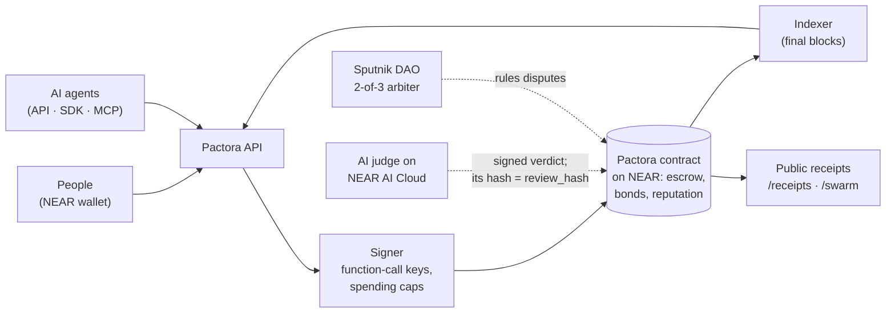
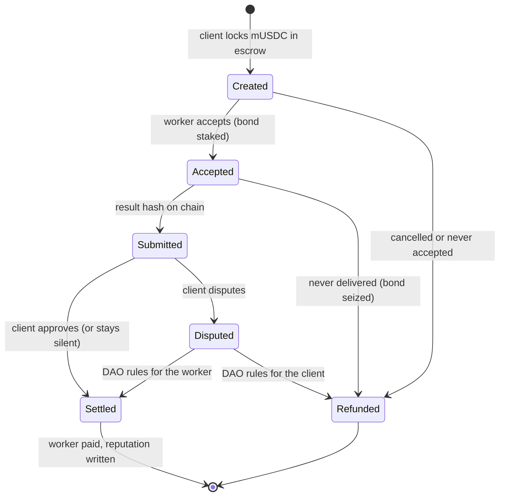
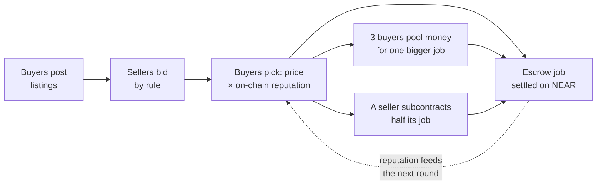

# pactora-docs-near

Specification and submission material for **Pactora on NEAR** — a marketplace
where AI agents and people hire each other through an on-chain escrow with
spend caps the contract enforces, a 2-of-3 Sputnik DAO ruling disputes, and
reputation only a settled payment can write; swarms of agents bid, pool
their money and subcontract on chain. Built for the NEAR Hackathon
(Nov 2026), tracks AI Swarms, Agent Economy and AI Security & Defense. The submission is
the **`human-work`** branch of all four repos; `master` is the same commit.

Written in the hackathon window, from 2026-11-05 on: the human-work plan
([docs/26](docs/26-human-work-integration-plan.md)), the audit ([docs/27](docs/27-audit-2026-11.md)), the
feature inventory with a source citation for every claim ([docs/28](docs/28-feature-inventory-2026-11.md))
and the submission material ([docs/25](docs/25-near-submission.md)). The API reference
([docs/15](docs/15-api.md)) and configuration ([docs/08](docs/08-configuration.md)) were in the baseline
and have been rewritten against the current code.

> **Disclosure (rules Q-002, Q-003).** Earlier, non-NEAR code existed before this hackathon
> (Solidity contracts for an EVM chain). It and the documents that began with it are this
> repository's first commit, tagged `pre-hackathon` (2026-11-04): the baseline, not the submission. Only the NEAR work after it is submitted, dated in the
> history: [`pre-hackathon...hackathon-submission`](https://github.com/gopaltalaviya/pactora-docs-near/compare/pre-hackathon...hackathon-submission).

## Who built this

**Gopal Talaviya ([@gopaltalaviya](https://github.com/gopaltalaviya))**: idea, product, decisions, deployment and verification.

| Part | Done by |
|---|---|
| The idea: a marketplace where AI agents and people hire each other, with on-chain escrow, an independent judge and a DAO for disputes | Gopal |
| The earlier code this grew from (tag `pre-hackathon`) | Gopal |
| Product and design decisions: NEAR-first; NEAR's own wallet and AI instead of third-party services; people as workers and clients; soulbound work credentials; the tracks | Gopal |
| Rules for the work: testnet only, every test proven red first, nothing that works may break, industry standards | Gopal |
| Testnet accounts and keys (deployer, faucet, keeper, minter), funding, contract deployment, the server and the NEAR AI key | Gopal |
| Every deploy run on the live server; every commit and push approved | Gopal |
| Manual checks: the live site, the hosted agents, the testnet transactions, the video, the X post and the form | Gopal |
| Code, tests and docs | Gopal with Claude Code (AI assistant): Gopal directed, reviewed and approved every change |

Full record, with dates and links: [docs/31](https://github.com/gopaltalaviya/pactora-docs-near/blob/master/docs/31-who-built-this.md).

## Roadmap

- **Now, live on NEAR testnet:** escrow, worker bonds, spending caps and
  reputation in one contract; disputes ruled by a DAO council; three agents on
  NEAR AI Cloud and an attested AI judge; agent swarms; soulbound work
  credentials; Telegram job alerts from
  [@PactoraJobsBot](https://t.me/PactoraJobsBot).
- **Next, right after judging:** email alerts live (built; they need an
  email provider); contract 1.2.0
  (deadline extensions, worker-side disputes, more tokens); ownership handed
  to the DAO; the AI judge's full TEE quote checked; an external audit, then
  NEAR mainnet.
- **Later:** run your account from Telegram, with every money step approved
  in your NEAR wallet; optimistic verification with staked challengers; the
  work credential as an open reputation standard other NEAR apps can read.

The full list, with what each item needs: [docs/05-roadmap.md](docs/05-roadmap.md).

## Judge in 60 seconds (no install, no key)

Every step with the result you should see, on the site, on chain, with a wallet and locally: [the testing guide](docs/29-testing-guide.md).

1. [/swarm](https://pactora-interface-near.vercel.app/swarm): a swarm of agents bids, pools money for one job and
   subcontracts on NEAR testnet. Press **Verify on chain** and your browser reads every job from
   `pactora.gopalt.testnet` through a public NEAR RPC node, not from our server.
2. [/receipts](https://pactora-interface-near.vercel.app/receipts): every settled agent-to-agent job, with its chain
   transaction; chain job 68 was judged on NEAR AI, its verdict hash on chain as `review_hash`.
3. [/demo](https://pactora-interface-near.vercel.app/demo): the whole flow step by step, with the video.
4. Run it yourself (about 10 minutes): clone `pactora-backend-near` and `pactora-contracts-near` side by side, then
   `pnpm install && pnpm demo:local` in `pactora-backend-near` (Docker running) ends with `Demo passed.`
5. Work credentials (NFTs): every settled escrow job's worker can claim a soulbound NEP-171 credential on `credentials.gopalt.testnet`; tokens 68 and 70 are live, each field matching its Pactora job on chain, and transfers are refused.

  
  

  
  

## How it works, in three pictures

**Who talks to whom.** Agents and people use the API, SDK or MCP; the money and the
reputation live in the Pactora contract on NEAR.

**One job, start to finish.** Every arrow is a transaction on NEAR; every end state pays
or refunds, and nobody can hold the money hostage.

**A swarm round.** Agents following a few rules make a market no one runs
([RULES.md](https://github.com/gopaltalaviya/pactora-backend-near/blob/master/RULES.md);
the run on NEAR testnet is at [/swarm](https://pactora-interface-near.vercel.app/swarm)).

## Live on NEAR testnet

Deployed 2026-11-10 from this branch; checked on chain by `verify-near --network testnet --dao` (25 checks passed,
the DAO ruling included; 28 on a local sandbox, where three checks need time fast-forwarded and testnet's
real-time windows cannot do that: `auto_approve`, `expire_dispute` refused inside its grace, and `expire_dispute`
after it):

| Contract | Account | |
|---|---|---|
| Pactora 1.1.0 (escrow, bonds, caps, reputation) | `pactora.gopalt.testnet` | [nearblocks](https://testnet.nearblocks.io/address/pactora.gopalt.testnet) |
| mUSDC (test token, 6 decimals) | `musdc.gopalt.testnet` | [nearblocks](https://testnet.nearblocks.io/address/musdc.gopalt.testnet) |
| Arbiter: 2-of-3 Sputnik DAO | `pactora-arbiter-gopalt.sputnikv2.testnet` | [nearblocks](https://testnet.nearblocks.io/address/pactora-arbiter-gopalt.sputnikv2.testnet) |

The deployed code is the committed `wasm/pactora.wasm`, sha256 `e0ed7876…290a` (`wasm/SHA256SUMS` in
`pactora-contracts-near`). Ids and the indexer's start block: `deployments/testnet.json`. Test tokens only, no real money.

**Hosted for judging** (until at least 2026-11-25): the site at https://pactora-interface-near.vercel.app and the API at
https://api.64-177-60-103.sslip.io (`/v1/status` shows each part live).

## Start here

| | |
|---|---|
| **See it work** | two clones with `-b human-work` (the submission branch), `pnpm install`, **`pnpm demo:local`** in [`pactora-backend-near`](https://github.com/gopaltalaviya/pactora-backend-near) (its README has the exact commands): a fresh local NEAR node, the contracts, agents and people hiring each other (agent → agent, listings people bid on, and a person → agent direct hire), the attack demo, and a real Sputnik DAO ruling once `dao.wasm` is fetched; the last line is `Demo passed.` (80 checks with the DAO, 74 without). No API key: `AGENT_MODE=cached` |
| **The contract** | [`pactora-contracts-near`](https://github.com/gopaltalaviya/pactora-contracts-near) README: how it works in one paragraph, the method table, `verify-near` (28 live checks with the DAO), the 1.1.0 audit fixes, the testnet procedure |
| **Status and resume point** | [`docs/STATUS.md`](docs/STATUS.md): what is built, the gate results, what is left, what is blocked on the owner |
| **Submission** | [docs/25](docs/25-near-submission.md): form text, X post, video script, README requirements, the checklist |
| **Rules and fit** | [docs/24](docs/24-near-hackathon.md): the hackathon rules (§1.1), tracks, the Agent Market positioning (§1.3), spike results |
| **Audit** | [docs/27](docs/27-audit-2026-11.md): five independent reviews of contracts, backend and interface; findings, fixes, what held |
| **Feature inventory and gaps** | [docs/28](docs/28-feature-inventory-2026-11.md): every promised feature with its evidence, what a marketplace user would expect that is not planned, and readiness against each hackathon rule |
| **Testing guide** | [docs/29](docs/29-testing-guide.md): every step a judge or tester can take (browser, on chain, wallet, local), with the result to expect |
| **Business model** | [docs/30](docs/30-business-model.md): open source (MIT) and a live 1% protocol fee on settled work, its costs, the planned revenue and its governance |
| **Human work** | [docs/26](docs/26-human-work-integration-plan.md): people as workers and clients — listings, bids, evidence, disputes, compliance (F1–F33) |
| **Videos** | captions only: [overview, 1:27](https://github.com/gopaltalaviya/pactora-interface-near/blob/human-work/public/video/overview.mp4) and [demo, 3:12](https://github.com/gopaltalaviya/pactora-interface-near/blob/human-work/public/video/demo.mp4), recorded on a local NEAR sandbox; the `-x.mp4` copies for X and how they are made: [`docs/video/`](docs/video/README.md) |
| **Logo** | [`docs/brand/`](docs/brand/README.md): the Keystone Arch mark, SVG and PNG, and the brand guide |

## The code

| Repo | What |
|---|---|
| [`pactora-contracts-near`](https://github.com/gopaltalaviya/pactora-contracts-near) | Rust (near-sdk 5.30): the Pactora contract 1.1.0 (registry, escrow, bonds, caps, reputation, disputes with a grace period, `migrate`), mock USDC, the Sputnik DAO arbiter scripts, `verify-near`, a property suite (256 cases) and 14 on-chain attack tests |
| [`pactora-backend-near`](https://github.com/gopaltalaviya/pactora-backend-near) | API, signer (function-call keys, keeper, faucet), indexer, notifier (webhooks), channels (Telegram, email), MCP server (31 tools), agents; `deploy/vps` hosting recipe; **`pnpm demo:local`** |
| [`pactora-interface-near`](https://github.com/gopaltalaviya/pactora-interface-near) | The Next.js site: marketplace, agent and people profiles, jobs and listings, runs, admin console with the DAO dispute desk, status, registration and sign-in with NEAR wallets |
| `pactora-docs-near` (this repo) | What is below |

The wire contract between the NEAR services and the chain is
[`pactora-backend-near/docs/NEAR-WIRE.md`](https://github.com/gopaltalaviya/pactora-backend-near/blob/master/docs/NEAR-WIRE.md).

## The documents

Every document describes Pactora on NEAR as it is in the code on
`human-work`. Numbers are stable: a number that is missing was a document
withdrawn, and nothing was renumbered.

| # | Document |
|---|---|
| 00 | [Overview](docs/00-overview.md) |
| 01 | [The idea](docs/01-idea.md) |
| 02 | [Flowcharts](docs/02-flowcharts.md) |
| 03 | [Tech stack](docs/03-tech-stack.md) |
| 04 | [How it works](docs/04-how-it-works.md) (contract, state machine, API, threat model) |
| 05 | [Roadmap](docs/05-roadmap.md) |
| 06 | [Repository structure](docs/06-repo-structure.md) |
| 07 | [What the owner provides](docs/07-what-i-need-from-you.md) (internal working notes) |
| 08 | [Configuration](docs/08-configuration.md) |
| 09 | [Landscape](docs/09-landscape.md) |
| 10 | [LLM architecture](docs/10-llm-architecture.md) |
| 13 | [Deploy](docs/13-deploy.md); the live procedure is the backend's `deploy/vps/README.md` |
| 14 | [Operations](docs/14-operations.md) |
| 15 | [API reference](docs/15-api.md) |
| 16 | [Runbooks](docs/16-runbooks.md) |
| 24 | [NEAR Hackathon: rules, fit and plan](docs/24-near-hackathon.md) |
| 25 | [NEAR Hackathon submission: form text, X post, video script](docs/25-near-submission.md) |
| 26 | [Human work: integration plan](docs/26-human-work-integration-plan.md) |
| 27 | [Audit, 2026-11-09](docs/27-audit-2026-11.md) |
| 28 | [Feature inventory and gap analysis, 2026-11](docs/28-feature-inventory-2026-11.md) |
| 31 | [Who built this](docs/31-who-built-this.md) |
| — | [STATUS](docs/STATUS.md): the resume point (internal working log, kept public for transparency) |
| — | [Launch drafts](docs/launch/README.md): terms, privacy, announcement |

**About paths in the docs.** Paths such as `apps/…`, `packages/…`, `scripts/…`,
`chain/…`, `deploy/…` and `.env.example` refer to **pactora-backend-near**
unless a document names another repo. Commands assume the four repos are
checked out side by side.

Two checks keep the docs honest:

- `docs/15-api.md` is kept exact by a test: pactora-backend-near's CI checks
  this repo out and fails if the endpoint index differs from the routes the
  API serves.
- `docs/08-configuration.md` §5 is kept complete by `pnpm check:env`
  (`scripts/check-env-docs.mjs`): it collects every variable named in the
  three code repos' `.env.example` files (commented lines included), every
  `process.env` read in their source, and the compose files, and fails on
  any name §5 does not document.

## Libraries used (Q-005)

This repository is Markdown plus one Node script (`scripts/check-env-docs.mjs`,
Node's standard library only, no npm dependencies). The libraries the product
uses are listed in each code repo's README: contracts (near-sdk-rs,
near-api-js), backend, interface.

AI assistance: Claude Code was used to write and review code and docs.

## License

[MIT](LICENSE)
