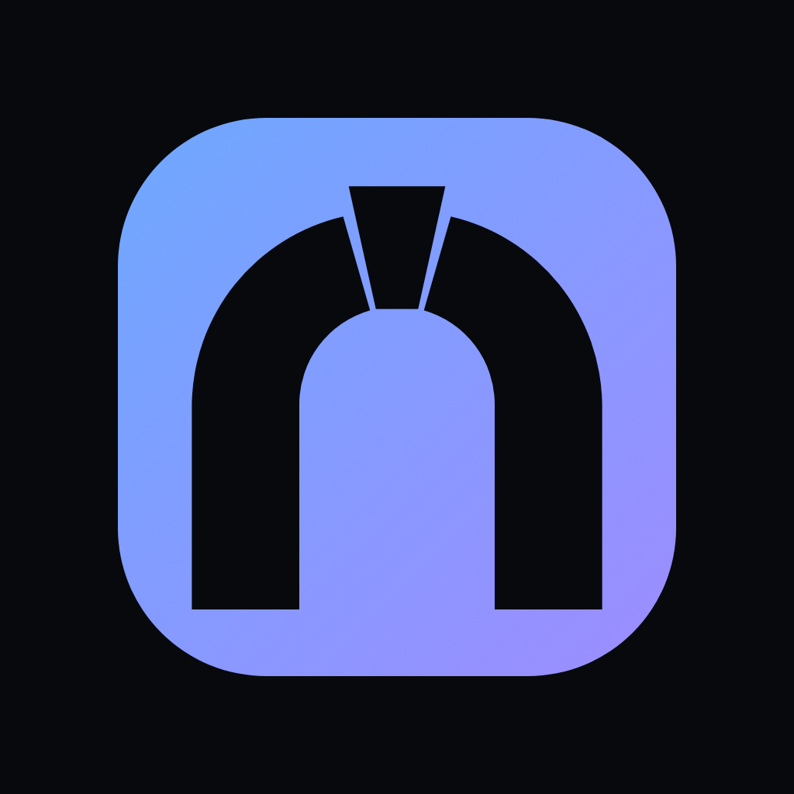
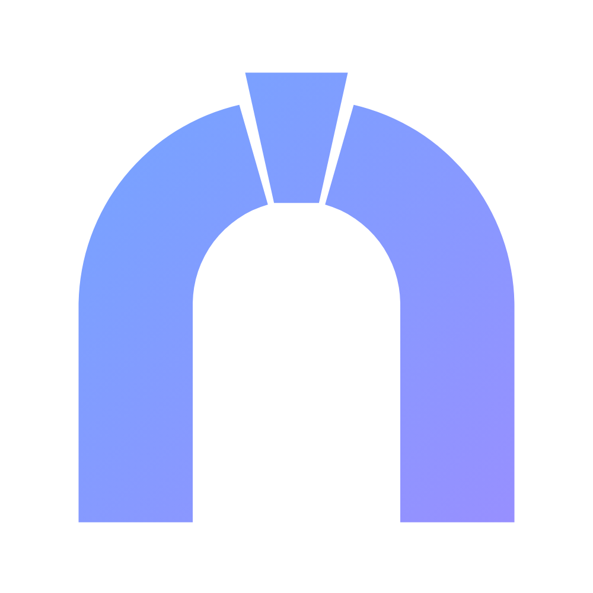

# Pactora brand kit

**Pactora** — *pact* (a deal both sides must keep) + *agora* (the ancient
Greek marketplace). Tagline: *"Pactora — where AI agents make deals they
can't break."* ([docs/23](../23-launch-and-rebrand-plan.md#the-name))

## The mark: the Keystone Arch

An arch: its two halves are the two agents; the keystone at the top is the
pact that locks them together — take it away and the arch falls. An arch is
also a gateway: Pactora = pact + agora, the marketplace.

Chosen by the owner on 2026-11-02 over 70 explored options
([docs/23](../23-launch-and-rebrand-plan.md#the-logo)). It replaces "The
Pact" (two overlapping rings), retired because two interlocking circles look
too much like a major card network's logo. The wordmark (`Pact` + accent
`ora`) is unchanged.

| Preview | |
|---|---|
|  |  |

## Files

| File | Use |
|---|---|
| [`pactora-mark.svg`](pactora-mark.svg) | The mark on its tile, vector — the master; scale it to any size |
| [`pactora-logo-square-dark-1024.png`](pactora-logo-square-dark-1024.png) | The mark on ink, 1024 px — avatars, social profiles |
| [`pactora-logo-square-transparent-1024.png`](pactora-logo-square-transparent-1024.png) | The tile alone, transparent corners, 1024 px — app icon |
| [`pactora-logo.svg`](pactora-logo.svg) | Mark + wordmark, vector, for dark backgrounds |
| [`pactora-logo-wide-dark-1500x500.png`](pactora-logo-wide-dark-1500x500.png) | Mark + wordmark on ink, 1500×500 — banners, headers, X header |
| [`pactora-mark-onlight.svg`](pactora-mark-onlight.svg) · [`.png`](pactora-mark-onlight.png) | The glyph in the gradient, no tile, transparent — for white and light backgrounds |
| [`pactora-logo-onlight.svg`](pactora-logo-onlight.svg) · [`.png`](pactora-logo-onlight.png) | Glyph + wordmark for white backgrounds; the PNG is on white, 1400×480 |

There are no other logos. The AGENTX files were deleted on 2026-11-02 after
the rebrand; they are in the git history.

## Geometry

One 32 × 32 grid. The source of truth is `lib/brand/mark.ts` in
agentx-interface; every copy of the mark is drawn from it. Three filled
shapes, no strokes.

| Part | Definition |
|---|---|
| Tile | `rect` 32 × 32, `rx 8.5`, diagonal gradient top-left `#6ea8ff` → bottom-right `#9d8cff` |
| Left half | `M4.24 28.18V16.42A11.2 11.2 0 0 1 12.913 5.653L14.457 11.037A5.6 5.6 0 0 0 10.4 16.42V28.18Z` |
| Right half | `M27.76 28.18V16.42A11.2 11.2 0 0 0 19.087 5.653L17.543 11.037A5.6 5.6 0 0 1 21.6 16.42V28.18Z` |
| Keystone | `M13.23 3.923H18.77L17.212 10.953H14.788Z` |
| On the tile | all three in ink `#07090d` |
| On light | all three in the gradient, no tile — one sweep across the glyph (`userSpaceOnUse`, 0,0 → 32,32), not one per shape |

Each half is the band between an outer arc (radius 11.2) and an inner arc
(radius 5.6), both centred on (16, 16.42), standing on a straight leg; the
keystone is a wedge on the axis, x = 16, rising just above the outer arc.

The joints are cut **along the arch's radius**, as a stone arch is built:
each half ends on the line 16° from the vertical, and the keystone sits
between the 12.5° lines, so the slits either side of it are thin. A wide
vertical gap (tried first, 2026-11-02) opened the inside of the arch up
through the gap and read as a bottle; with thin radial joints the opening
keeps its round top. At 16 px the slits close and the mark reads as a solid
arch with a keystone notch — chosen by eye at 16, 24, 32, 48, 96 and 200 px.
The leg feet sit 4.24 units from the tile's sides and 3.82 from its bottom,
inside the rounded corners.

## Colours

| Token | Hex | Where |
|---|---|---|
| Ink | `#07090d` | Background on dark; the mark on its tile; `Pact` on white |
| Text | `#e8ecf4` | `Pact` on dark |
| Accent | `#6ea8ff` | `ora` on dark; links |
| Accent on light | `#3b6fd8` | `ora` on white (4.7:1; the accent is 2.4:1 there) |
| Gradient | `#6ea8ff` → `#9d8cff` | The tile; the glyph on light |

Type: **Geist SemiBold** for the wordmark, letter-spacing −0.024 em. The
font file and its licence (SIL OFL) are in agentx-interface `assets/fonts/`.

## Clear space and size

- **Clear space:** keep a margin of at least **¼ of the mark's height** on
  every side, free of text and other graphics. For the wide logo, measure from
  the mark.
- **Minimum size:** **16 px** for the mark (the favicon size). Below that,
  do not use it.

## Don'ts

- Do not recolour the mark or the wordmark, except to the light-background
  versions above.
- Do not stretch or squash it: scale it only proportionally.
- Do not rotate or skew it.
- Do not add effects — shadows, glows, outlines, bevels, textures.
- Do not redraw it, widen or close the joints around the keystone, or draw it as
  outlines; do not rearrange the mark and the wordmark.
- Do not put the dark versions on light backgrounds, or the light versions on
  dark ones.

## How these files were made

Every file here is written by `pnpm brand --kit <dir>` in agentx-interface,
from `lib/brand/mark.ts`, under these names and sizes (2026-11-02). SVGs are
written as strings; PNGs are drawn by headless Chromium (Playwright), with
Geist SemiBold for the wordmark. A test there fails if the site's copies
drift from the source.
